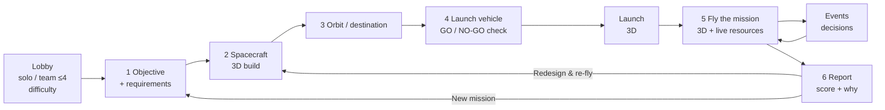

# 04 · Game Concept: Shared Skeleton

> This is the **basic structure every version shares**. It isn't a full design. Each team member gives their version **its own flavour** on top of this skeleton (see the **Your flavour** notes in each phase and the freedom zones in [09-build-guide.md](09-build-guide.md) §5).
> Checklist IDs ([03](03-requirements-checklist.md)) show which requirement each part satisfies.
> Golden rules apply: **meet the challenge requirements · 3D · interesting.**

---

## 1. Core idea

**One line:** *A 3D game where a player (or a crew of up to four) picks a scientific goal, builds a spacecraft, chooses an orbit and rocket, launches, flies the mission, and learns how every trade-off shaped the result.*

**Core message:** *Every mission is a trade-off. There's no single perfect mission. Redesign, re-fly, learn.*

**Players:** students and space-curious people with **any** level of knowledge (Space Apps lists the challenge as **Beginner/Youth** and **Intermediate**).

**Session length (suggested):** one mission in about 10–15 minutes, and a redesign-and-re-fly loop in about 3–5 minutes.

**Working title:** "Mission Forge". **Each version may use its own name.**

### Design pillars (shared)

| Pillar | Meaning |
|---|---|
| **Every choice ripples** | No choice is isolated. Each one moves several resources at once. |
| **No single perfect mission** | Several different designs can succeed. |
| **See it, don't just read it** | 3D makes the consequences visible. |
| **Learn by failing safely** | Failure is explained and cheap to retry. |
| **Better together** | Solo works, and a team of up to 4 makes it richer. |

---

## 2. Core loop (shared skeleton)

The six numbered steps (**Objective → Spacecraft → Orbit → Launch vehicle → Fly → Report**) must exist in every version, in that logical order. They are the challenge's *"from concept to operation"* (M12). How each step looks and plays is up to you.

---

## 3. Phases: what's required vs your flavour

### Phase 0: Start / Lobby · R1, R2, R9
- **Required:** start a new mission, choose **solo** (team optional but recommended), choose a difficulty if you have levels.
- **Basic contents:** mode (Solo / Team up to 4), role assignment in team mode ([07](07-team-mode-and-roles.md)), difficulty (for example, Beginner / Standard / Expert).
- **Your flavour:** a mission-control room, a space-academy menu, a 3D Earth title screen, a crew briefing…

### Phase 1: Define the mission objective · M2, R9, R14
- **Required:** the player picks an objective (**≥2 options**) and sees its **requirements** before designing.
- **Basic contents:** objective name, goal sentence, destination, requirements (instrument types, science target, lifetime, budget), critical resources.
- **Starter objectives** (from [06](06-game-systems-and-data.md)): Earth Observation · Lunar Science · Mars Explorer · Deep-Space Observatory (L2) · CubeSat Starter (beginner).
- **Your flavour:** add your own objectives (asteroid survey, space weather monitor, comet flyby…), as long as they keep the same trade-offs. Present them as mission cards, a briefing room, or a star-map selection.

### Phase 2: Build the spacecraft · M3, M4, M7, M8, R8, T1
- **Required:**
  - **3D spacecraft** that visibly changes as parts are chosen.
  - Subsystems: **structure, power, batteries, communications, onboard computer, attitude control, scientific instruments** (the challenge's list).
  - **≥2 instrument choices** with different mass, power, cost, data and science.
  - **Live resource display:** mass, power, budget, data, communications, time (lifetime) + science value.
  - **Trade-off feedback** when a choice changes other resources.
- **Your flavour:** slot menus, drag-and-drop in 3D, grid placement with physical size, part cards. Simple/advanced parts by difficulty.

### Phase 3: Choose the orbit / destination · M6, R6
- **Required:** **≥2 orbit options** with plain-language pros and cons. The choice must change something real (comms, eclipses/power, lifetime, observation, launch capacity).
- **Basic contents:** orbit name, real distance (as text), a simple explanation, effects on the mission. Orbits that don't fit the objective are locked **with a reason**.
- **Your flavour:** a 3D orbit preview, a draggable altitude slider, an interactive solar-system map.

### Phase 4: Choose the launch vehicle · M5, M9, R7
- **Required:** **≥2 rockets** with different payload capacity (per orbit) and cost, plus a **compatibility check** (mass vs capacity to that orbit, budget, other rules) that shows **reasons and fix hints**.
- **Basic contents:** a GO / NO-GO panel: ✓ fits · ⚠ warning · ✗ blocked + why.
- **Your flavour:** a 3D rocket lineup, a launch-pad view, a countdown review.

### Launch · M10, T1, T2
- **Required:** a **3D launch** of the chosen rocket.
- **Basic contents:** liftoff → ascent → stage separation (or similar) → arriving in space.
- **Your flavour:** a cinematic, a timing mini-game, throttle control, weather delays.

### Phase 5: Fly the mission · M10, R10, R11, T1
- **Required:** the mission is **simulated over time**, and the outcome depends on the design. A **3D orbit/trajectory view** shows the spacecraft on its path.
- **Basic contents:** a live dashboard (mission time, power use vs generation, battery, data stored, downlink, contact with ground stations), time speed control, at least one decision moment during flight (events).
- **Your flavour:** real-time, turn-based "mission months", event-card driven, manual pointing or observation mini-games.

### Events and decisions · R11, R2, N6
- **Recommended:** random or scripted events (solar storm, part failure, ground-station outage, bonus discovery…) with **choices that are themselves trade-offs**. In team mode, decide by vote ([07](07-team-mode-and-roles.md)).
- **Your flavour:** the event catalogue, frequency, and presentation.

### Phase 6: Mission report · M11, R3, R4, R12
- **Required:**
  - Result (success / partial / failure) + score.
  - **"Why" explanation tied to the player's own decisions** (≥2 specific points).
  - Requirements from Phase 1 shown as met or not met.
- **Recommended:** score breakdown (objectives, science, efficiency, collaboration/decisions), **Redesign & re-fly**, leaderboard.
- **Your flavour:** a mission-review board, a newspaper headline, a debrief with your crew, "real missions like yours" cards ([08](08-educational-content.md) §7).

---

## 4. Modes and difficulty (basic)

| Mode | Tier |
|---|---|
| **Solo** | Required (you need at least one way to play) |
| **Team, up to 4** (local hot-seat at minimum) | Recommended (R1) |
| Sandbox (no limits) | Nice to have (N4) |
| Competitive (teams, same objective) | Nice to have (N3) |

Difficulty levels (recommended, R9) can change: available part tiers, budget size, hint level, event frequency.

---

## 5. Screens checklist (minimum set)

1. Title / menu · 2. Lobby (mode, roles, difficulty) · 3. Objective select + requirements · 4. Spacecraft build (3D) + resource HUD · 5. Orbit select · 6. Launch vehicle select + GO/NO-GO · 7. Launch (3D) · 8. Flight view (3D) + dashboard · 9. Event decision · 10. Mission report · 11. Settings · 12. Credits / Learn more (resources from [02](02-challenge-resources.md)).

A tutorial overlay is recommended ([08](08-educational-content.md) §5).

---

## 6. Reference example: one possible flavour

To show how the skeleton becomes a game, here's **one example walkthrough** (a "deep-space observatory" mission). It's an illustration, not a template to copy.

| Step | What happens in the example |
|---|---|
| Opening | Earth rises in 3D. Title text: "Every mission is a trade-off." |
| Lobby | Team of 4: Mission Planner, Spacecraft Engineer, Science Lead, Comms & Resources. Difficulty "Engineer". All crew ready. |
| Objective | Four mission cards (Earth Observation, Lunar Science, Mars Explorer, Deep-Space Observatory). The team picks the Observatory. Requirements: large telescope · cold, stable orbit · high data downlink · 5-year lifetime · fixed budget. |
| Spacecraft | Parts snap onto a 3D craft one by one: structure, solar arrays, batteries, computer, attitude control, antenna, telescope. The resource panel fills up. An instrument upgrade shows a trade-off popup: + science, + mass, + power, + data, + cost: "Every decision has a consequence." |
| Orbit | LEO vs GEO vs Sun–Earth L2, with simple pros and cons. L2 is chosen for a cold, stable view. |
| Launch vehicle | Light (too heavy ✗), Medium (fits ✓), Heavy (over budget ⚠) → LAUNCH CHECK: GO. |
| Launch | Countdown, liftoff, stage separation, Earth's curvature. |
| Fly | A 3D map shows four pathways (LEO, Moon, Mars, L2). The craft travels to L2 and images distant galaxies. The live dashboard shows power, battery, data and the next ground pass. |
| Event | Solar storm: power −30%. Team vote: safe mode vs keep observing → safe mode. Explanation: at 70% power, the instruments would drain the battery. |
| Report | Mission success. Breakdown: objectives, science, efficiency, collaboration. "Why" bullets reference the upgrade, the rocket choice and the safe-mode vote. Leaderboard. Redesign & re-fly. |
| Closing | "No single perfect mission. Redesign. Re-fly. Learn." |

**Your version should feel different**: another theme, art style, build mechanic or flight mechanic, as long as the skeleton and the [03](03-requirements-checklist.md) checklist are fully covered.
